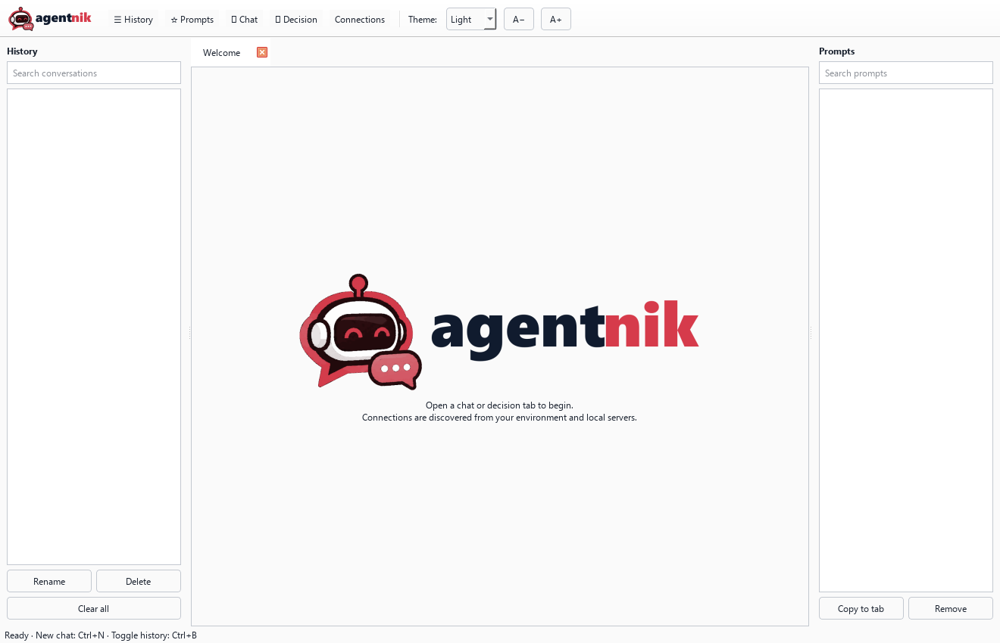
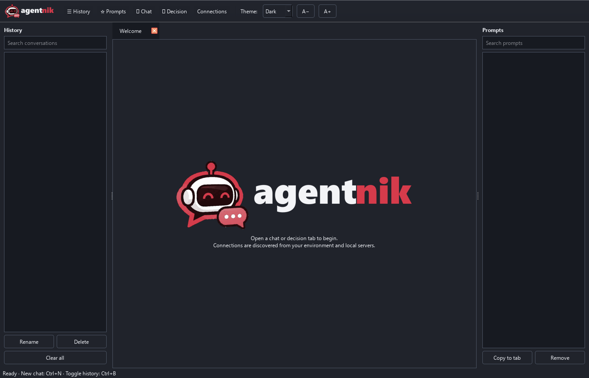
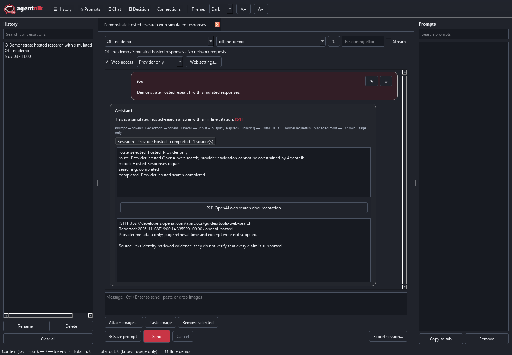
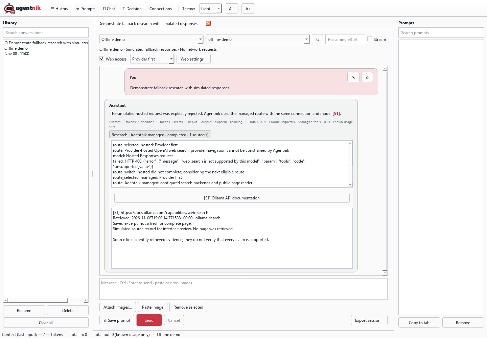

# Agentnik


A Python/Qt desktop client for LLM conversations, Ollama System One decisions, and experimental managed web research. The initial desktop targets are Windows, macOS, and Linux.

## Screenshots




These welcome screens were rendered offline with temporary data.

## Install and launch

Use Python 3.11 or newer with matching Qt wheels for your OS and architecture. A virtual environment is recommended for dependency isolation, but is optional.

Windows PowerShell:

```powershell
python -m venv .venv
.\.venv\Scripts\python.exe -m pip install -r requirements.txt
.\.venv\Scripts\python.exe agentnik.py
```

After installation, `./start.ps1` opens the desktop app without leaving a console window. Run the Python command above when troubleshooting so startup errors remain visible.

To use your existing Python installation directly instead:

```powershell
python -m pip install -r requirements.txt
python agentnik.py
```

macOS / Linux:

```sh
python3 -m venv .venv
.venv/bin/python -m pip install -r requirements.txt
.venv/bin/python agentnik.py
```

Alternatively, `python -m pip install .` installs the `agentnik` desktop entry point. Linux still requires the system libraries used by Qt's platform plugin; the exact packages depend on the distribution.

Optional key files can be supplied with `--litellm-key-file PATH` and `--ollama-key-file PATH`; use `--litellm-url URL` for a custom LiteLLM endpoint. Keys are read into the process environment and are saved only when you explicitly save a connection. Do not commit key files.

## Validation and build tools

See [DEVELOPMENT_VALIDATION.md](DEVELOPMENT_VALIDATION.md) for the opt-in live compatibility CLI and repeatable Windows development archives. Both tools print a plan by default; live requests require `--execute`, and builds require `--build`. The compatibility CLI requires an exact model/protocol/route and makes no automatic retries or fallback.

## Project status

Milestones B and C provide a bounded research preview with native Ollama and Responses managed tools, OpenAI Responses hosted search, all four route policies, visible fallback, sources, persistence, and shared accounting. Scoped live LiteLLM checks passed streamed chat and tool continuation for selected ChatGPT/Ollama Cloud aliases, plus real managed search and page retrieval using `chatgpt/gpt-6-luna`; see [live results](MILESTONE_D_LIVE_RESULTS.md). Other models/routes remain unverified. Milestone D now includes Chat Completions and Messages managed adapters; live compatibility, broader platform checks, and distribution readiness remain outstanding; see `AGENTNIK_PLAN.md`.

Post-v0.2.0 development includes **Repositories** for local Git repositories or ordinary folders, a searchable **＋ Code** picker, and independent coding panes. Removing or relocating a registry entry preserves files/history and each pane's original directory snapshot.

Agentnik now owns its coding loop using your existing connections and models, with no Codex runtime dependency. Assign Heavy and optional Light models independently, including different LiteLLM aliases/providers. Use **Choose model…** to list aliases, or enter one manually. Heavy plans and proposes edits; it can delegate bounded routine analysis to Light within the same workflow. File content and delegated context go to the selected endpoints. Model listing does not prove tool compatibility.

**Run coding task** can inspect project files and propose UTF-8 file edits. Review the full diff, then approve or reject each edit. Existing files must be read first; conflicting changes stop the write. Cancellation retains your draft and already applied approved edits. No commands, deletion, directory creation, commits or pushes are available. Safety recommendations show **Not checked** because System One review is not connected yet. Reopening never restarts a run; model assignments persist without keys. You can explicitly include the displayed, bounded previous task and answer in a follow-up run.

The separate **Try simulated workflow (no execution)** option remains available. The coding backend has offline protocol/Qt/file-operation coverage; live coding model compatibility is not yet established. These changes are newer than the v0.2.0 archive. Follow the [coding guide](CODING_GUIDE.md) to set up a project, select models and review edits; see [the coding backend plan](CODING_BACKEND_PLAN.md) for implementation boundaries and remaining execution gates.

## Conversations

Use **＋ Chat** or **＋ Decision** to select a connection and open a session. Tabs are independent, including tabs that use the same connection. Changing the connection selector opens a new session. Models load automatically when a tab opens; use the refresh icon to reload them. A manually entered model works even when listing models is unavailable. New manually created connections default to Responses; discovered and saved connections retain their configured protocol.

Chat supports OpenAI-compatible Chat Completions, Responses, and Anthropic Messages. Streaming is enabled by default and can be turned off for endpoints that do not support it. Reasoning effort is optional and must be supported by the selected model. Unsupported parameters produce a visible endpoint error rather than a silent retry that might duplicate a billed request. Web research is opt-in. Managed tools support native Ollama, Responses, Chat Completions, and Messages; hosted search uses the official OpenAI Responses endpoint. Ordinary chat does not execute tools.

Chat uses rounded message cards: your prompts sit to the right and assistant replies to the left. Each card grows to hold the complete message, with one outer scrollbar for the conversation. Assistant Markdown renders during streaming as well as after completion, including wrapped code blocks. **Show thinking / Hide thinking** expands reasoning inline in the same card; streamed reasoning is initially visible and respects your toggle choice.

The composer starts at a compact height. Drag the divider above it to resize it; Agentnik remembers the chosen height. **A− / A+**, beside the **Theme** dropdown, decrease or increase the application's font size from 8 to 32 points. Font changes apply immediately to existing conversations, editors, and controls, and are remembered between launches. Hover over either font button to see the current size.

The toolbar, welcome screen, and window icon use the robot mark recolored to match the red wordmark. The lowercase **agentnik** wordmark uses dark/light `agent` lettering and red `nik` lettering. Themes use matching red interface accents. Packaged SVGs contain paths, with transparent PNG fallbacks and a Windows ICO. `assets/robot.svg` is the reusable robot source; `tools/build_branding.py` builds the wordmarks using PySide6 and Pillow. Pillow is a build-only dependency. Generated assets require no installed font at runtime.

Select several images with **Attach images**, drop files onto the attachment area or composer, or paste an image into the composer. The attachment tray previews images in request order. Double-click a thumbnail to open its stored copy. PNG, JPEG, WebP, and GIF are accepted by the app; actual model/provider format support varies. **Ctrl+Enter** sends the prompt. The draft and attachments remain available if the request fails or is cancelled.

**Cancel** immediately stops accepting results for that request and releases the tab. Cancellation does not guarantee that the server stops computing or billing; a blocked transport worker can remain alive until its network timeout. Other tabs stay usable.

## Web research preview

New chats start with **Web access** off. Choose a model, open **Web settings…**, and explicitly enable the research capabilities you want for that endpoint/model. Configure the connection's default route and navigation policy there; use the dropdown beside **Web access** to override the route in one chat. **Connection default** follows the saved default, initially **Provider first**. Existing managed-only chats retain **Agentnik only** when upgraded.

| Policy | Route order |
| --- | --- |
| Provider first | Hosted, then managed when an eligible fallback is safe |
| Agentnik first | Managed, then hosted when an eligible fallback is safe |
| Provider only | Hosted only |
| Agentnik only | Managed only |

Both routes always retain the selected model, connection, and endpoint. A single-route policy never changes route. Missing backends, unknown/unconfigured capabilities, and known unsupported routes are skipped with a recorded reason; there are no background inference probes. Protocol compatibility alone does not establish capability.

### Provider-hosted search

Enable **OpenAI-hosted web_search** only for a model that supports that tool on the official `https://api.openai.com/v1` Responses endpoint. The control is unavailable for compatible gateways and other protocols. Model support and restrictions must be checked against the [official OpenAI web-search documentation](https://developers.openai.com/api/docs/guides/tools-web-search); enabling the checkbox records **configured**, not **verified**. No particular OpenAI model has been live-validated in this preview.

The provider performs search inside the submitted Responses request using its conversation input and inference credential; no managed search key is required. Agentnik parses search progress, source metadata, citation annotations, completion/failure, and available usage. Stateless requests preserve complete output/continuation items, including encrypted reasoning, rather than flattening them into assistant text. Source metadata without a page excerpt or retrieval timestamp is labeled accordingly; Agentnik records when the provider reported it.

### Agentnik-managed tools

Managed tools support native Ollama (the detected port 11434 route or direct Ollama.com chat), Responses, Chat Completions, and Messages, each explicitly enabled per endpoint/model. Chat Completions retains assistant tool calls and `tool_call_id` results. Messages retains signed/redacted thinking blocks and groups matching `tool_result` blocks in a user message. Streamed arguments are assembled before any tool executes; malformed, duplicate, or truncated calls stop the turn. System One is separate from research.

Configure a separate Ollama search API key in **Web settings…**, or use **Manage ordered search backends…** to add, edit, reorder, and remove independently credentialed profiles. The initial adapter uses [Ollama's search API](https://docs.ollama.com/capabilities/web-search); additional service adapters remain future work. Up to five profiles can participate. The optional `OLLAMA_WEB_API_KEY` profile follows saved profiles when there is room and no saved default profile. Inference `OLLAMA_API_KEY` is never reused for search. Removing a saved profile does not unset an environment key.

Search credentials use the **Agentnik Web** credential store, with an explicit plaintext fallback. Keys and credential references are excluded from histories and ordinary session exports. Only the generated query and result limit are sent to the search service, not the complete conversation or image attachments; queries can still contain prompt-derived information. Configured credentials are blocked from generated tool arguments and scrubbed from returned tool content and persisted activity.

### Navigation boundaries

**Public page reads; external search navigation disclosed** enables these routes with their stated limitations. Managed page reads validate HTTP(S) URLs, all DNS addresses, and every redirect; connect to a vetted IP while preserving TLS hostname verification; and reject credentials in URLs, private/local/reserved destinations, IPv6 transition addresses, and ports outside 80/443. Page requests send no provider keys, search keys, cookies, or proxies. HTML/plain text is extracted as inert text; compressed and unsupported content is rejected. Some sites are consequently unavailable.

Search services and the hosted provider control their own internal navigation. Agentnik cannot apply its destination checks inside those services. **Enforce public-only navigation everywhere** therefore disables both currently implemented external search routes before submitting any request. The activity view explains the skipped routes; it never falls back to bypass this restriction. Ollama service-backed page fetch remains disabled for the same reason.

### Fallback and limits

Explicit unsupported-tool rejections and authentication rejection can move to the next eligible route when the policy permits. A narrow HTTP 400 tool rejection records **unsupported**; unrelated API errors never establish tool incompatibility. HTTP 403 access restrictions stop the turn.

Explicit HTTP 429/503 rejection with no partial activity permits one retry per route and a bounded wait. `Retry-After` is honored up to the five-second wait limit; longer guidance stops the turn and asks for an explicit later restart. After that retry, a two-route policy may consider its other route. A managed search call can try the next configured backend after a definite eligible rejection without replaying the model request. Duplicate profiles/credentials are not retried. Empty results are passed back to the model; they do not trigger transport fallback.

Timeout, disconnection, unknown execution outcome, partial assistant output/reasoning, partial tool/search activity, cancellation, blocked URLs, and access restrictions stop automatic replay. Partial work and available usage remain saved; the draft remains editable. Cancellation rejects late results and stops scheduling work, while remote processing and billing may continue. Reopening interrupted history never restarts requests.

| Bound | Default per turn |
| --- | --- |
| Managed tool rounds / all tool calls | 4 / 8 |
| Model requests across routes and retries | 6 |
| Route attempts / saved search profiles | 8 / 5 |
| Search results per managed call | 5 |
| Web response / total managed retrieved bytes | 1 MB / 3 MB |
| Search excerpt / page excerpt | 3 KB / 8 KB |
| New assistant/tool continuation context | 32 KB |
| Model response / tool arguments | 512 KB / 4 KB |
| Request / total turn duration | 45 s / 180 s |
| Retry wait / page redirects | 5 s / 3 |

The collapsible **Research** view records route/backend selection, reasons, retries, searches, page reads, errors, sources, and excerpts. The route is also shown in the completion status. Both provider annotations and validated managed `[S1]` references render as prominent clickable inline citations. Unknown references and invalid provider offsets do not become verified links. Sources identify recorded evidence; they do not prove claim support. Saved excerpts retain original timestamps and are not fresh complete pages. Saved structured continuation is capped at 128 KB; open a new chat when it reaches the limit.

Reported tokens are summed across attempts, including failed requests when usage is supplied. Latest-input context is separate from the token sum and remains unknown when the last attempt did not report it. Missing usage is labeled **Known usage only**. Total elapsed time includes backoff and tools. **Managed tools** measures app-controlled tool latency; hosted tool latency remains unknown unless separately reported. Generation rates and costs are never inferred from unavailable provider measurements.





These screenshots use explicitly simulated responses. Rebuild hosted/fallback/settings screenshots offline with `python tools/capture_routing.py`; `tools/capture_research.py` renders the native managed demo.

## System One query builder

Decision tabs use a form with shared state/context, an optional JSON-state toggle, images, and multiple named questions. Drop image files or paste clipboard images directly into the state field to add them to the attachment tray. Each question has instructions and one of three types:

- **Yes / No**: no choices required; displays the probability of yes and no.
- **Multiple choice**: 2–26 unique labels with descriptions.
- **Ordered score**: 2–10 descriptions entered from lowest to highest. Labels are not sent for this type.

All questions are sent in one `/v1/systemone` request. Images are encoded as bare base64, independently of the chat formats. For an image-only query, Agentnik supplies a short state describing the attached images because System One requires nonempty state. The endpoint must run a compatible decision model; ordinary chat models do not become decision models by selecting this tab.

Every completed run is preserved with its submitted form and raw response. **Restore query to form** makes an older query editable without deleting newer runs. Returned probabilities appear as horizontal bars. Multiple-choice results also offer a button to switch to a pie chart when the returned values form a probability distribution. Scoring levels use the model's returned legend when available. Confidence is shown separately from probability.

## Prompts

Click the **✎** icon on a previous chat prompt to copy its text and images into the composer for editing and resending. Earlier messages remain unchanged; sending adds a new turn to the current conversation. Replacing a different, nonempty draft asks for confirmation. Editing does not send a request or save a favorite.

Use **☆ Save prompt** beside the composer or decision form to save the current draft. Star a past chat message or decision run to save its submitted prompt. The collapsible **Prompts** panel lists saved prompts for the active tab's type; search covers chat text or decision state, questions, and choice descriptions. Select a prompt and choose **Copy to tab**, or double-click it, to restore it to the active tab. If that tab already has a different draft, Agentnik asks before replacing it. Copying does not send a request or change the tab's connection or model.

Saved chat prompts include text and images. Saved decision prompts include the state, JSON mode, images, and ordered questions and criteria. They persist across restarts independently of conversation history; clearing history does not remove them. Images remain stored while any saved prompt or session references them. Click a filled star or use **Remove** in the panel to remove a saved prompt. The panel's visibility is remembered.

## History and statistics

The collapsible sidebar contains persistent chat and decision sessions. It supports search, rename, delete, and **Clear all** with confirmation. Closing a tab keeps its history. Deleting history closes the affected tabs and removes images that are no longer referenced by another saved session. Saved connections remain available. **Ctrl+B** toggles history; **Ctrl+N** opens a new chat.

Malformed or newer-version session records appear as **Unavailable saved session**. Their original database payload is preserved; restore/repair the record or use a compatible Agentnik version to reopen it. Other valid sessions remain usable. Attachment cleanup retains files while unreadable records might reference them. Explicitly confirmed history deletion still removes selected records.

Images are copied into application storage and shared by content hash. History stays usable when original image files move. Drafts and decision form edits are saved automatically. Session export produces JSON containing messages, submitted forms, results, and local attachment paths; it does not bundle image files or credentials.

The bottom status bar shows the active session's latest reported input-context token count, effective context limit when known, and cumulative reported input/output tokens. Local Ollama's loaded-model metadata is queried for its effective context length after a chat response. Other connections can supply a limit in the connection editor; unknown limits display **—**. This is not a tokenizer estimate or a claim that the model's entire advertised window is configured on the server. For native Ollama chat, a configured limit is also sent as `options.num_ctx`.

Research waits share a process-wide limit of 16 background workers, including nested DNS/backend work. Cancelled operations keep their slots until they actually exit; further requests report a capacity limit instead of spawning unbounded workers. Cancellation does not guarantee remote computation or billing stops. Stalled system DNS can occupy a slot until the OS resolver returns. Public fetches can try up to eight distinct approved addresses before sending HTTP, under one TCP/TLS connection deadline; TLS errors are terminal and submitted HTTP requests are not replayed.

New research metadata has a separate 256 KB retention limit. If exceeded, the answer remains available while continuation data and other detail are reduced; the activity/completion view reports the limit. Incomplete continuation is disabled, so start a new chat for further research. Existing saved history is not rewritten. This budget is separate from tool-context and response-size limits.

Reported cache/read-write and reasoning token details are retained as numeric usage records when provided. Cumulative streaming counts are updated per request, then summed across requests. Messages input totals include its separately reported cached tokens; cache/reasoning details already included in other protocol totals are not counted twice. Missing values remain unknown and no cost is inferred.

Each response/run shows prompt and generated token counts, total elapsed time, prompt-processing rate, generation rate, and thinking time when meaningful. Local Ollama and direct Ollama Cloud chat use `/api/chat` to obtain native timing/count fields. When a stage rate is unavailable, **Overall tok/s** shows `(input tokens + output tokens) / elapsed seconds`, provided both counts and a positive elapsed time are known. This includes the full request time and is labeled separately from generation speed; unavailable measurements display **—**. The fallback also works for previously saved responses. Thinking time is explicitly labeled as an estimate based on streamed reasoning arrival; hidden reasoning and non-streaming responses do not expose reliable thinking duration. Zero generated tokens is a valid System One result.

## Connections and discovery

**Connections** combines saved connections, environment settings, and local server candidates. **Refresh discovery** rescans these loopback ports, trying IPv4 and IPv6:

| Candidate | Ports |
| --- | --- |
| Ollama | 11434 |
| llama.cpp | 9931, 8080 |
| FastFlowLM | 52625 |
| LiteLLM | 4000 |

An open port appears even if its API requires authentication. Model-list probes distinguish compatible APIs from unverified open ports. Service names derived from port numbers are candidates; Ollama's version endpoint is used to confirm Ollama. Discovery does not scan the LAN or automatically issue inference requests. Custom addresses and ports can be entered manually.

Environment discovery supports: OpenAI, Anthropic, LiteLLM, Ollama, llama.cpp, OpenRouter, Groq, Together, Mistral, DeepSeek, xAI, and Bedrock Mantle. It recognizes their API-key, base-URL, and model settings. Mantle uses bearer API keys, not AWS Runtime signing. Environment connections are saved only when explicitly copied through the connection manager. Environment-discovered wildcard hosts (`0.0.0.0`) are normalized to `127.0.0.1`, preserving the scheme, port, and path. Explicitly entered or saved connection URLs are unchanged. Matching environment and port-probed endpoints appear once, under the environment connection name. Environment credentials, protocol, and selected model take precedence; a probe can supply a missing model. Probe status appears in the connection tooltip. Matching normalizes localhost/127.0.0.1, default ports, and base-URL formatting, while preserving different schemes, ports, and paths.

**Import** accepts validated JSON files with a top-level `connections` mapping. Imports are validated and previewed before saving; duplicate names can be skipped, replaced, or renamed. **Export** exports selected entries, or all entries when none are selected. API keys are excluded by default; including them requires an explicit choice. Credential-store references are never exported.

Saved API keys use `keyring` and the OS credential store. The editor offers explicit plaintext storage if needed. History contains a connection name and settings snapshot, not an API key. If a saved connection's URL changes, old sessions do not silently receive its key. Endpoint redirects are rejected so credentials are not automatically forwarded to a different address.

Default local data directories:

- Windows: `%LOCALAPPDATA%\Agentnik`
- macOS: `~/Library/Application Support/Agentnik`
- Linux: `$XDG_DATA_HOME/agentnik`, or `~/.local/share/agentnik`

`--data-dir PATH` or `AGENTNIK_HOME` overrides the directory. Connections use JSON; session history uses Python's built-in SQLite. Light/dark/system theme and sidebar visibility are remembered.

Research verification is scoped to the endpoint, protocol, model, and an opaque connection context. Different saved accounts and session credential overrides do not share verification. Editing a saved connection or changing observed environment credentials requires a fresh compatibility check. Legacy explicit enablement can remain configured, but older unbound verification is not carried forward. Environment and unsaved legacy credential scopes last only for the current application/store lifetime; saving a connection creates a persistent scope. Keys and key fingerprints are not stored in capability records. Externally changed credentials or upstream model mappings still require an explicit recheck.

If saved connection settings are malformed or use an unsupported version, startup reports how to repair them and preserves the original file. Restore a known-good `connections.json` or repair its JSON/settings, then restart. Agentnik does not silently replace the file or remove credential references.

## Validation

```powershell
python -m unittest discover -s tests -v
python -m compileall -q agentnik tests tools
```

Ordinary tests are offline and use temporary storage. They cover provider wire formats, streaming, cancellation, decisions, credentials, attachment cleanup, independent tabs, saved prompts, font controls, theme switching, and packaged branding. `tools/live_smoke.py` is an optional endpoint check; running it lists models, and `--generate` or `--decision-model MODEL` issues inference. Run live checks only when authorized. No live endpoint compatibility is claimed for this baseline.

Windows source and offscreen Qt checks are recorded in `VALIDATION.md`. macOS/Linux runtime behavior remains unverified. The first Windows frozen build passed startup and clean-exit smoke checks; see `VALIDATION.md`.

## Packaging

The Windows x64 release is **v0.3.0**. Extract the complete `Agentnik-v0.3.0-windows-x64.zip` archive and run `Agentnik/Agentnik.exe`; keep its `_internal` folder beside it. Python is bundled. See [release notes](RELEASE_NOTES.md) and the bundled `BUILD-MANIFEST.json` for changes and build evidence. The build is unsigned. Research remains a preview with scoped live compatibility results; full native workflow, clean-machine, and macOS/Linux validation remain pending. Earlier release tags and archives are preserved.

The Python wheel has been built and installed locally; see [validation results](VALIDATION.md). To build a wheel without resolving runtime dependencies:

```powershell
python -m pip wheel . --no-deps --wheel-dir dist
```

Build and test on each target OS; a Windows build does not produce a macOS or Linux application. For an initial distributable, install PyInstaller as a build-only dependency and run:

```powershell
python -m PyInstaller --noconfirm --windowed --name Agentnik --icon agentnik/assets/agentnik-icon.ico --add-data "agentnik/assets:agentnik/assets" --collect-submodules keyring.backends agentnik.py
```

Verify credential storage, TLS access, file dialogs, clipboard images, history, and Qt platform plugins in each packaged build. Signed installers and automatic updates are future distribution work.

## License

MIT. Copyright (c) 2026 Nikolaus Spence. Author: Nikolaus Spence.
