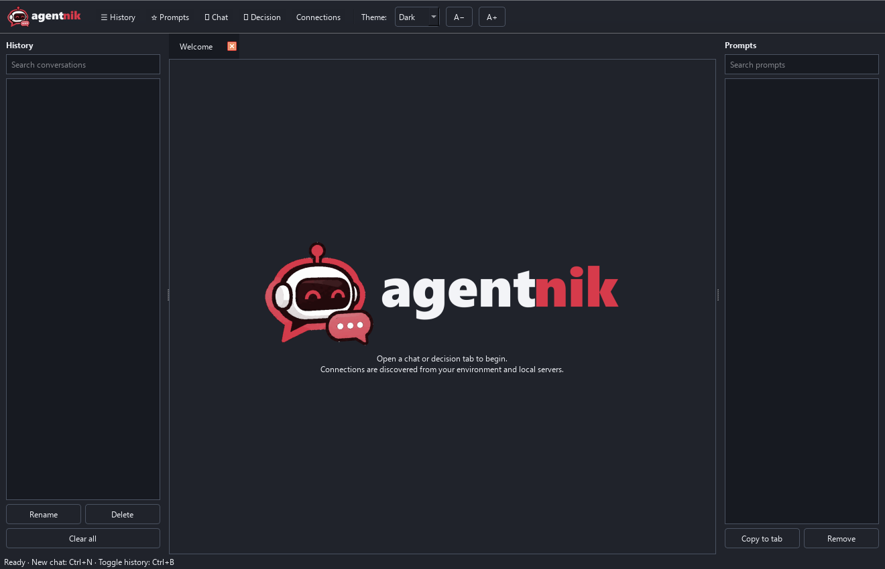
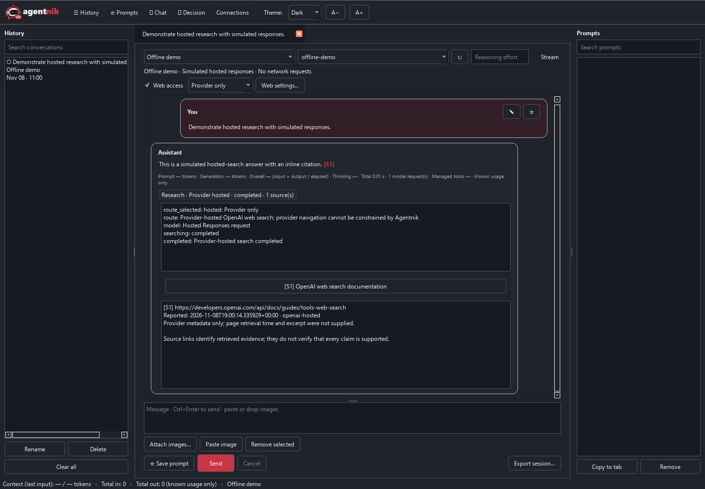

# Agentnik

**Code, chat, and research with your choice of local or cloud models.** Agentnik is a Python/Qt desktop application for Windows, macOS, and Linux. It brings model connections, conversations, projects, and research into one workspace, using Ollama, LiteLLM gateways, and compatible provider endpoints.

## What you can do

- **Code with your model:** work in local repositories or folders using Agentnik's own coding loop. Choose a model, delegate bounded analysis and artifact creation to subagents using that model, inspect and edit files, run shell commands and tests with a configurable approval switch, and use structured Git tools. [Coding features](CODE_FEATURES.md) · [Coding guide](CODING_GUIDE.md)
- **Plan with specifications and tracks:** the built-in **Spec & Plan** workflow follows a Conductor-style approach: draft requirements, a specification and a task plan, review project changes, then start a selected track. Persistent project context, editable drafts, task IDs and progress reconciliation keep larger changes organized. [Spec & Plan guide](CODING_GUIDE.md#spec--plan-track-preview) · [Track format](TRACK_FORMAT.md)
- **Extend workflows with Skills and MCP:** select repository or user Skills and connect local or remote MCP servers, including OAuth with a pre-registered public client or supported dynamic registration. Code can use supported tools, text resources, templates and prompts; Chat offers an opt-in preview for MCP tools, resources and prompts. MCP tools can write or perform external actions without approval. [Skills and MCP](CODE_FEATURES.md) · [Chat tools](CHAT_GUIDE.md)
- **Chat with images and documents:** keep conversations in independent tabs with Markdown, streaming, visible thinking, saved prompts, history and token statistics. Attach images and supported documents in Chat or Code, optionally generate or edit images using an image provider, and use local calculator and data-analysis tools. [Chat and history](CHAT_GUIDE.md) · [Coding guide](CODING_GUIDE.md)
- **Research the web:** combine managed search and public-page retrieval, or use hosted search on eligible OpenAI Responses connections. Sources, citations, activity and fallback are visible; configured search providers can also supply place, image and entity results. [Research guide](RESEARCH_GUIDE.md) · [Search providers](SEARCH_PROVIDERS.md)
- **Get shell command advice:** optionally use an Ollama System One decision model to advise on shell-command approvals in Code. [Coding guide](CODING_GUIDE.md)
- **Choose connections and keep local history:** use native Ollama or compatible Responses, Chat Completions and Messages endpoints, including LiteLLM gateways and supported cloud connections. Manage credentials, persistent sessions and attachments, prompt history, context compaction, themes and language settings. [Connections and local data](CONNECTIONS.md) · [Feature inventory](FEATURES.md)

Spec & Plan is a native Agentnik feature inspired by Conductor. It uses Agentnik's own track format and configured models; upstream plugin or track compatibility is not claimed. Reported progress requires user judgment.

For testing System One Decision models with varying states, images, and questions, we recommend [Promptnik](https://github.com/nikspence/promptnik).

Research and coding workflows include preview features. Model listings do not establish support for tools, images, research or System One. See [validation](VALIDATION.md) for observed behavior and remaining platform and compatibility checks.

## What Agentnik is not

Agentnik is not a remotely controlled or unattended automated agent. You start and direct work in the desktop application; Code can continue through steps of a goal while the application is running. Agentnik does not connect to messaging services and is not intended for multi-agent orchestration. Code subagents perform bounded work within a user-started run.

## Get started

Agentnik requires Python 3.11 or newer. See [installation and launch](GETTING_STARTED.md) for Windows, macOS and Linux instructions, or use the Windows archive described below. Endpoint, credential and storage configuration is covered in [connections and local data](CONNECTIONS.md).

## Windows release

The **v0.11.0** Windows x64 build is an unsigned onedir ZIP. Extract the complete archive and run `Agentnik/Agentnik.exe`, keeping `_internal` beside it. Python is bundled. Verify the accompanying SHA-256 checksum. Build-host startup results are recorded in the archive. This release has not been separately qualified on a clean machine; macOS/Linux distribution validation remains outstanding. See [release notes](RELEASE_NOTES.md) and the archive's `BUILD-MANIFEST.json` for details.

## Screenshots

These welcome screens were rendered offline with temporary data. Research screenshots below use simulated responses.

## Documentation and development

- [Coding features](CODE_FEATURES.md) and [coding guide](CODING_GUIDE.md): model selection, project tools, Spec & Plan, Skills, and MCP.
- [Chat and history](CHAT_GUIDE.md): attachments, prompts, history, and controls.
- [Research guide](RESEARCH_GUIDE.md) and [search providers](SEARCH_PROVIDERS.md): routes, configuration, sources, and limits.
- [Connections and local data](CONNECTIONS.md): endpoints, credentials, discovery, and storage.
- [Features](FEATURES.md), [validation](VALIDATION.md), and [development and builds](DEVELOPMENT_VALIDATION.md): feature inventory, evidence, offline checks, and release tooling.
- [Project roadmap](AGENTNIK_PLAN.md): remaining work and qualification priorities.

Ordinary tests use temporary storage and do not issue live inference. Build and validate on each target OS. Pillow is needed to rebuild branding assets, not to run Agentnik. See [DISCLAIMER.md](DISCLAIMER.md) for responsibility and use information.

The toolbar **Web** and **MCP** switches apply to new Chat and Code runs. **Settings** controls which tool wins a name conflict. Use **Settings** for shared search priority and providers, research and coding limits, optional Decision-model shell advice, and TLS verification. Select the Code model at the top of each Code pane. Settings changed during a run apply to the next run. Web defaults off.

## License

Apache-2.0. Copyright 2026 Nikolaus Spence. Sole author: Nikolaus Spence.
